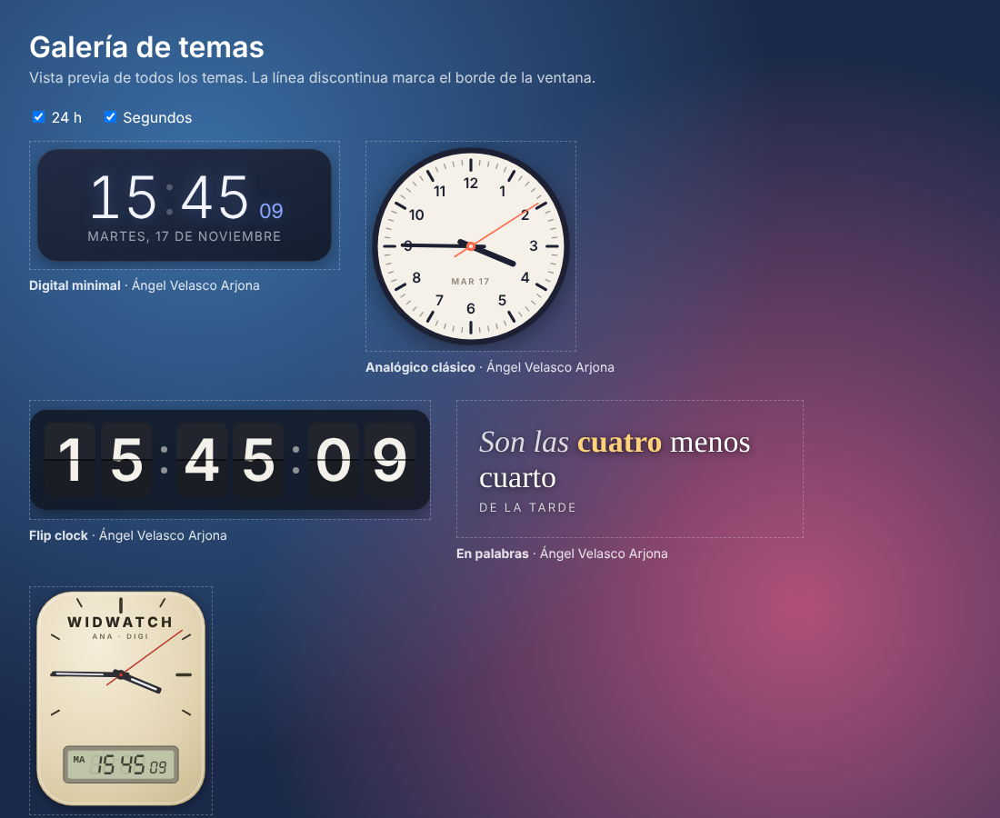

# WidWatch ⏰

Reloj de escritorio para Windows, ligero, de código abierto y con **temas creados por la comunidad**.



## Qué hace

- Ventana **transparente y sin bordes** que puedes arrastrar a cualquier sitio (recuerda la posición).
- Tres modos: **normal**, **siempre encima** o **pegado al escritorio** (como un widget).
- **Bloquear**: los clics atraviesan el reloj para que no estorbe.
- Menú en la **bandeja del sistema** y con **clic derecho** sobre el reloj: tema, tamaño (50–200 %), formato 24 h, segundos, iniciar con Windows.
- Respeta la opción de Windows **"Mostrar animaciones"**.
- Pesa unos pocos MB gracias a [Tauri 2](https://tauri.app) (usa el WebView2 que ya trae Windows).

### Temas incluidos

| Tema | Qué tiene de especial |
|---|---|
| **Digital minimal** | Dos puntos que laten, fecha en español. El más fácil de copiar. |
| **Analógico clásico** | SVG con segundero de barrido suave a 60 fps. |
| **Flip clock** | Tarjetas que se voltean con animación 3D. |
| **En palabras** | «Son las tres y cuarto de la tarde». |
| **Ana-Digi retro** | Reloj de pulsera ochentero: agujas, segundero de cuarzo con rebote y LCD de 7 segmentos que se ilumina al pasar el ratón. |

## Instalar

Descarga el instalador `.exe` o `.msi` desde [Releases](../../releases).

## Desarrollar

Requisitos: [Node.js 20+](https://nodejs.org), [Rust](https://rustup.rs) y las [dependencias de Tauri para Windows](https://tauri.app/start/prerequisites/) (Microsoft C++ Build Tools y WebView2).

```bash
npm install
npm run dev        # abre el reloj con recarga en caliente
npm run build      # genera el instalador en src-tauri/target/release/bundle/
```

**¿Solo quieres diseñar un tema?** No necesitas Rust:

```bash
npm install
npm run preview    # y abre http://localhost:5173/gallery.html
```

## Estructura

```
src/                     ← todo lo visual (HTML/CSS/JS, sin bundler)
  host.js                ← carga temas, reparte el "tick", arrastre y menú
  gallery.html           ← vista previa de todos los temas
  themes/
    themes.json          ← lista de temas activos
    digital/  analog/  flip/  text/
    _plantilla/          ← punto de partida para un tema nuevo
src-tauri/               ← núcleo en Rust
  src/lib.rs             ← ventana, bandeja, menú, comandos
  src/settings.rs        ← ajustes en %APPDATA%
```

## Contribuir

¡Los temas nuevos son la mejor forma de empezar! Lee [CONTRIBUTING.md](CONTRIBUTING.md): crear uno lleva unos 10 minutos.

### Hoja de ruta

- [ ] Cargar temas desde una carpeta del usuario sin recompilar
- [ ] Opciones propias por tema (colores, fuentes) definidas en el `manifest.json`
- [ ] Varios relojes a la vez (p. ej. distintas zonas horarias)
- [ ] Alarmas y temporizador
- [ ] Traducciones de la interfaz

## Licencia

[MIT](LICENSE) © Ángel Velasco Arjona y colaboradores.
